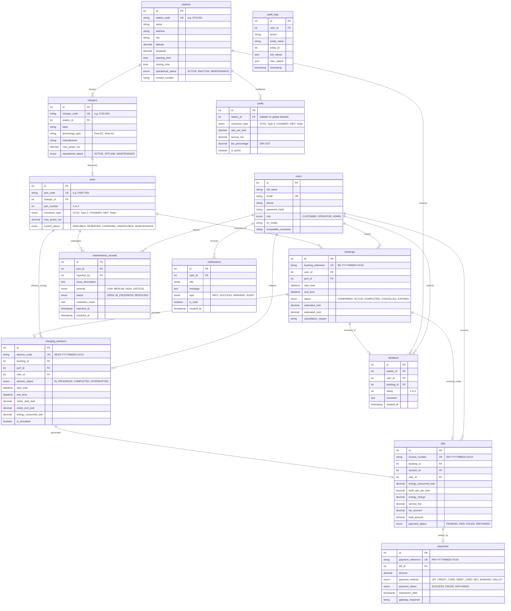

# Entity-Relationship (ER) Diagram & Structural Analysis

## 1. Conceptual ER Architecture

The **EV Charging Slot and Billing Management System** is modeled in compliance with relational database standards and normalized up to **Third Normal Form (3NF)**.

### Primary Problem Solved in Schema Design:
Preventing ambiguity regarding **which physical charger owns which port**. In real EV plazas, multiple dispensers exist at one station, and each dispenser houses multiple charging connector cables/guns. The relational schema enforces an inviolable foreign key chain:
$$\text{stations } (1) \longrightarrow (N) \text{ chargers } (1) \longrightarrow (N) \text{ ports}$$

---

## 2. Mermaid Entity-Relationship Diagram

---

## 3. Cardinality & Relationship Breakdown

| Parent Table | Child Table | Relationship | Cardinality | Enforced Foreign Key | Business Invariant |
| :--- | :--- | :--- | :--- | :--- | :--- |
| `stations` | `chargers` | One-to-Many | 1 : N | `chargers.station_id` ➔ `stations.id` | A physical charger belongs to exactly ONE station. |
| `chargers` | `ports` | One-to-Many | 1 : N | `ports.charger_id` ➔ `chargers.id` | A port belongs to exactly ONE charger dispenser. |
| `ports` | `bookings` | One-to-Many | 1 : N | `bookings.port_id` ➔ `ports.id` | Slot bookings are made on a specific port dispenser. |
| `users` | `bookings` | One-to-Many | 1 : N | `bookings.user_id` ➔ `users.id` | A registered user can book multiple charging slots. |
| `bookings` | `charging_sessions` | One-to-One | 1 : 1 | `charging_sessions.booking_id` ➔ `bookings.id` | Exactly one session activates a confirmed reservation. |
| `charging_sessions`| `bills` | One-to-One | 1 : 1 | `bills.session_id` ➔ `charging_sessions.id` | Prevents duplicate invoicing of the same charging session. |
| `bills` | `payments` | One-to-Many | 1 : N | `payments.bill_id` ➔ `bills.id` | Multiple payment attempts or refunds per invoice. |
| `ports` | `maintenance_records` | One-to-Many | 1 : N | `maintenance_records.port_id` ➔ `ports.id` | Tracks individual port hardware maintenance history. |
